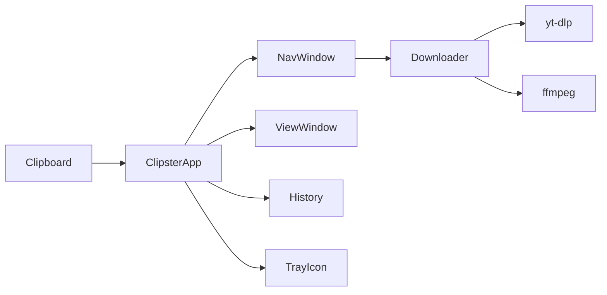

# Technical documentation

Architecture notes for **Loresoft YouTube Clipster** (`clipster/` package). Accurate to the current Python codebase (v2).

## Overview

Clipster is a cross-platform desktop app that:

1. Watches the clipboard for YouTube URLs.
2. Downloads audio/video via **yt-dlp** (+ **ffmpeg** post-processing).
3. Shows progress in a small **navigation window** and a larger **view window** (download list, settings, about).

Entry points: `run.py` → `clipster.cli` (bootstrap / venv / deps) → `ClipsterApp` in `clipster.app`.

## High-level architecture



### Clipboard monitor and download pipeline

`ClipsterApp` (`app.py`) owns the main loop:

- Polls the clipboard every `config.interval_sec` via `clipboard.Clipboard`.
- Recognises YouTube URLs through `downloader.extract_youtube_url`.
- Queues links (up to `MAX_QUEUE`); with `parallel_downloads` several workers may run.
- Fetches metadata, prompts for format / audio language via `bridge.Prompt` + `NavWindow`, then runs `Downloader`.
- Appends outcomes to `history.History` (`history.json`) and refreshes `ViewWindow`.
- Optional side effects: clear clipboard, open folder, open view window, tray tooltip.

Worker threads never touch Tk widgets directly; they call back through `TkBridge`.

### Navigation and view windows

| Window | Module | Role |
|--------|--------|------|
| Hidden Tk root | `gui.Gui` | Owns the process; hosts both windows |
| Nav window | `navwindow.NavWindow` | Format / track / section choice, progress, result |
| View window | `viewwindow.ViewWindow` | Pages: Downloads, Settings, About |

The download table keeps its geometry in one place: `ViewWindow._configure_columns()` applies the
same column widths to the heading strip and to every row, so the two can never drift apart.

- **Sorting** — `_COLUMNS` ties a sort key to its grid column, `_SORT_KEYS` says how that column
  compares (`size` by bytes, not by the rendered `9 MB`). `set_sort()` toggles the direction when
  the same column is clicked again; `_visible_entries()` filters and then sorts, stable, so equal
  rows keep their history order. The order therefore survives a re-render.
- **Column widths** — `_col_widths` holds the pixels per fixed column; the name column has
  `weight=1` and absorbs the rest. The grips are *placed*, not gridded: an extra grid cell in the
  header would take it out of step with the rows. A drag calls `set_column_width()`, which nudges
  only the changed column on the header and the mounted rows instead of rebuilding the table.
  `_widen_for_headings()` measures the headings once at build time so no clickable heading is
  clipped, in any language.
- **Long names** — `_fit_line()` cuts a name to the pixel width of its cell; the `<Configure>`
  handler feeds the full name to a `tooltip.Tooltip` whenever the shown text differs, and clears it
  again when the name fits. Nothing that is fully visible gets a tip.

`Gui.build_windows()` constructs both. `show_view(page)` deiconifies the view and may select a page (`downloads`, `settings`, `about`). Closing the view usually hides it when the tray is active; Quit ends the process.

### Download pipeline (details)

`downloader.Downloader`:

- Uses yt-dlp for info extraction and download.
- Progress callbacks populate `Progress` for the nav UI.
- Post-process: MP3 extract or MP4 merge via ffmpeg; conversion progress is read from ffmpeg `-progress` output.
- Errors are classified (`bot`, `unavailable`, `metadata`, …) for history and messages.

**Sections.** `download(..., section=ClipRange)` cuts one piece out instead of taking the whole video:

- `clip.parse_range()` turns the two nav window fields into a `ClipRange` (or one of the `clip_error_*` message keys). It clamps an end beyond the video, refuses a start behind it, and returns `None` when the fields describe the whole video anyway.
- yt-dlp gets `download_ranges` (a plain callback, not the `download_range_func` helper) plus `force_keyframes_at_cuts`, so the cut lands on the named second rather than the nearest keyframe.
- `clip.output_template()` puts `[1-23_2-45]` in front of the extension. Without it the clip would take the file name of the full download, and since `overwrites` is off, yt-dlp would skip the download and hand back the full file.
- The section length replaces the video length for the progress bar, the disk space check and the history entry; `HistoryEntry.section` holds `ClipRange.key()`, and `History.find_download()` compares it, so a clip is never offered as "already downloaded" for the whole video.

### Config and terms

- `config.Config` — JSON under the app data dir (or portable `config.json` next to `run.py`).
- `terms.py` — versioned acceptance: `TERMS_APP_VERSION`.
- App terms gate startup (`ClipsterApp._ensure_app_terms`).
- UI: `Gui.ask_terms_acceptance` (checkbox + Accept/Decline) and `Gui.show_terms_document` (About / read-only).

### Tray

`tray.TrayIcon` (pystray) when `use_tray` is true and the backend works. Click opens the view window; menu offers Show / Open folder / Quit. Without a tray, the view window stays visible and closing it quits.

### Asking before installing

`install_system_packages` consults a confirm function and installs nothing on a no (exit code
`DECLINED`, distinct from any real failure). It is a module-level hook (`set_install_confirm`) rather
than an argument on all fifteen `ensure_*` functions - they all funnel through one place anyway, and the
setup scripts had to keep working untouched. `bootstrap(ask=True)` sets `console_confirm` and drops it
again on every exit path, including the aborted ones; the hook is process wide.

`console_confirm` says yes when there is no terminal. That is the point: `run.bat` and a double-clicked
`run.py` have no tty, and a question nobody can see must not stall the setup. Under `pythonw.exe` the
streams are `None` rather than merely not a tty, which is why `_interactive()` checks for the object
before asking it anything.

Privilege escalation had to grow a second path for the window. `sudo -p` writes its prompt to a tty; with
no tty it simply fails, so `privileged_script(..., graphical=True)` uses an already-valid sudo timestamp
if there is one, then `pkexec` (which brings its own dialog), and returns `None` rather than a command
that would hang. Commands are joined with `;`, not `&&`, so one broken third-party repository breaking
`apt-get update` does not also cancel the install - the exit status is the install's.

### Bootstrap / installer

`cli.py` + `installer.py` + `dependencies.py`: ensure Python, tkinter, venv, yt-dlp, ffmpeg, clipboard helpers, optional tray stack. `setup_ui.py` shows the setup window while deps install - naming the component in progress, and reporting an unfinished setup in a dialog, because `run.bat` starts `pythonw.exe` and there is no console to print to.

### Single-file executable (frozen mode)

`build-exe.py` builds a PyInstaller one-file executable for the system it runs on. It sets up a
build venv in `build/exe/`, writes a spec file and checks the result with `--version`. Inside the
executable `paths.IS_FROZEN` is set, and a few things work differently:

- **Sources as data.** The files of the checkout (`source_members` in `build-exe.py`) travel
  as data under `sys._MEIPASS/youtube-clipster/`, together with the commit marker. `PROJECT_ROOT`
  points there, so icons and `clipster/locales` work unchanged.
- **No venv, no pip.** `sys.executable` is the program itself; running it with `-m pip` would start
  Clipster. `installer.bootstrap` skips the venv. Tray and PyGObject are bundled, and their
  steps only look in-process (`_bundled_step`).
- **yt-dlp from outside.** `ensure_ytdlp_zipapp` downloads yt-dlp's own release (a zip that
  includes yt-dlp-ejs) to `install_dir()/yt-dlp.pyz`. `paths.use_external_ytdlp` puts it on
  `sys.path` before the first import. yt-dlp's helper packages and the whole standard library are
  bundled, because the yt-dlp that arrives later may import any of them.
- **Updates from releases.** `updater.check`/`apply` read `releases/latest` instead of the branch
  head. They compare the build number in the tag `v<version>-build<build>` and download the
  asset `paths.executable_name(version, build)` next to the running file. The name carries the
  version, so nothing is overwritten, and Windows would refuse to overwrite a running `.exe`
  anyway. The old path is kept in `state.json`. `finish_executable_update()` in the new program
  points the desktop shortcut and autostart at itself and deletes the old file. While the old file
  is still running, the deletion waits for the next start. `restart()` starts the new file and sets
  `PYINSTALLER_RESET_ENVIRONMENT`, so it unpacks itself afresh.
- **Child processes get the system's libraries.** PyInstaller points `LD_LIBRARY_PATH` at the
  unpacked files, and its GTK hooks do the same for `GI_TYPELIB_PATH`, `GTK_PATH` and others.
  Inherited, these variables would make FFmpeg or the file manager load the program's
  libraries. `paths.use_system_environment_for_children()` therefore wraps `subprocess.Popen` once
  at startup. Each child gets `paths.child_environment()`: every entry pointing into
  `sys._MEIPASS` is dropped, and `LD_LIBRARY_PATH` gets its original value back.
- **Shortcuts** start the executable itself. The Linux launcher icon is copied into the data
  folder, because the unpacked copy is gone when the program ends.

`.github/workflows/release-exe.yml` runs the same script on Ubuntu 22.04 (oldest glibc, system
Python for PyGObject) and Windows, then publishes the release.

## Module map

| Module | Purpose |
|--------|---------|
| `__init__.py` | App name / version constants |
| `__main__.py` | `python -m clipster` |
| `app.py` | Clipboard monitor, download orchestration, terms gates |
| `bridge.py` | Marshal calls onto the Tk thread (`Prompt`, callbacks) |
| `cli.py` | CLI flags, bootstrap, relaunch into venv |
| `clip.py` | Section downloads: time parsing, validation, file name marker |
| `clipboard.py` | Cross-platform clipboard backends |
| `config.py` | User settings dataclass + load/save |
| `dependencies.py` | Declarative dependency table |
| `downloader.py` | yt-dlp / ffmpeg integration |
| `gui.py` | Tk root, window ownership, terms dialogs, toasts |
| `history.py` | Download history model + `history.json` |
| `i18n.py` | Locale JSON loader |
| `installer.py` | Install missing deps |
| `logging_setup.py` | Console + file logging |
| `navwindow.py` | Small download prompt / progress window |
| `paths.py` | Platform paths; `YOUTUBE_CLIPSTER_HOME` override |
| `setup_ui.py` | Early setup window: progress, failure dialog |
| `shortcuts.py` | Desktop shortcut + autostart |
| `singleinstance.py` | Single-instance lock |
| `terms.py` | Terms version helpers |
| `theme.py` | Dark palette + ttk styles |
| `tray.py` | System tray icon |
| `updater.py` | GitHub update check / apply / restart |
| `scroller.py` | Scrollable container shared by the table and the settings page |
| `tooltip.py` | The hover popup of the download list |
| `viewwindow.py` | Large multi-page window |
| `locales/*.json` | UI strings (`en`, `de`) |

## Configuration keys overview

Defaults live on `Config` and in `config.example.json`.

### General

| Key | Default | Meaning |
|-----|---------|---------|
| `language` | `en` | UI language (`en` / `de`) |
| `download_dir` | `""` | Empty → OS downloads folder |
| `interval_sec` | `2.0` | Clipboard poll interval |
| `show_startup_notification` | `true` | Startup toast |
| `default_format` | `mp3` | Nav window preselection |
| `open_view_after_download` | `false` | Open view when a download finishes |
| `history_limit` | `100` | Max history rows |
| `check_updates` | `true` | GitHub update check |
| `parallel_downloads` | `false` | Concurrent downloads |
| `max_parallel_downloads` | `3` | Cap when parallel |
| `use_tray` | `true` | System tray icon |
| `start_minimized` | `true` | Start without showing the view |
| `open_folder_after_download` | `false` | Reveal folder on success |
| `file_manager` | `""` | Explicit file manager command |
| `clear_clipboard_after_download` | `true` | Clear clipboard after success |
| `ask_audio_language` | `true` | Ask when multiple audio tracks exist |
| `no_playlist` | `true` | Never download whole playlists |
| `restrict_filenames` | `false` | ASCII filenames |
| `output_template` | `%(title)s.%(ext)s` | yt-dlp output template |
| `user_agent` | `""` | Optional HTTP user agent |
| `cookies_from_browser` | `""` | yt-dlp `cookiesfrombrowser` (`firefox` / `chrome` / …; empty = off) |
| `cookies_file` | `""` | Path to Netscape `cookies.txt` for yt-dlp |
| `ask_desktop_shortcut` | `true` | Ask once about a desktop shortcut |
| `autostart` | `false` | Login autostart |
| `update_check_hours` | `24` | yt-dlp update cadence (`0` = every start) |
| `log_level` | `INFO` | Logging level |

### Terms

| Key | Meaning |
|-----|---------|
| `terms_app_version` / `terms_app_accepted_at` | Accepted app terms revision + UTC timestamp |

`path` on `Config` is the file location and is **not** serialised into JSON.

## Data locations

| Item | Linux / macOS | Windows |
|------|---------------|---------|
| Config / log / history | `~/.local/share/YoutubeClipster/` | `%LOCALAPPDATA%\YoutubeClipster\` |
| Venv | same `…/venv` | same |
| Override | env `YOUTUBE_CLIPSTER_HOME` | same |
| Portable config | `config.json` next to `run.py` | same |
| yt-dlp of the executable | same `…/yt-dlp.pyz` | same |

Tests set `YOUTUBE_CLIPSTER_HOME` to a temp dir (see `tests/conftest.py`) so the suite never touches real user data.

## Testing how-to

Dev deps: `pip install -r requirements-dev.txt` (venv recommended).

```bash
# Full suite (GUI tests need a display; use xvfb on headless Linux)
.venv/bin/python -m pytest

# Without GUI
.venv/bin/python -m pytest -m "not gui"

# GUI only, headless
xvfb-run -a .venv/bin/python -m pytest -m gui

# Focused modules
.venv/bin/python -m pytest tests/test_config.py tests/test_downloader.py -v

# Network tests (deselected by default)
.venv/bin/python -m pytest -m network
```

Markers are defined in `pytest.ini`. Contract / cross-platform checks also live under `tests/`.

### Doc screenshots

Anonymized UI captures for the README / user guide:

```bash
xvfb-run -a -s "-screen 0 1400x900x24" .venv/bin/python tools/capture_screenshots.py
```

Writes PNGs under `docs/images/` using the real Tk UI and fixture data (no personal paths, example.com-style ids).

## Related docs

- [User guide](USER_GUIDE.md) — install, settings, troubleshooting
- [README](../README.md) — features, install, screenshots
