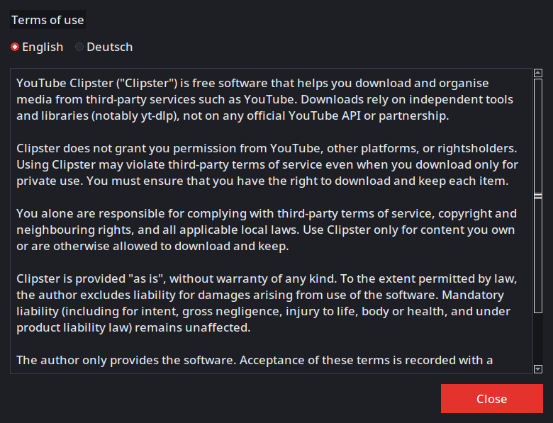
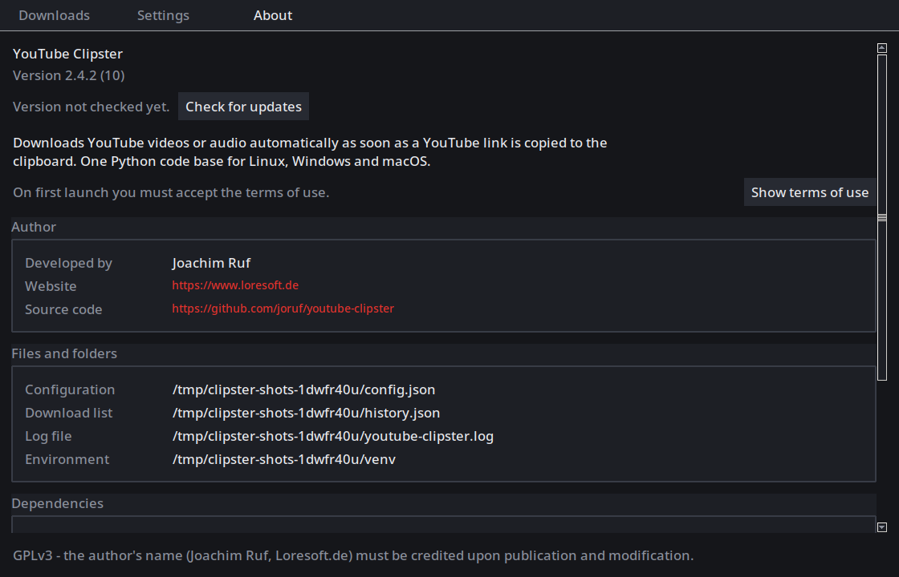
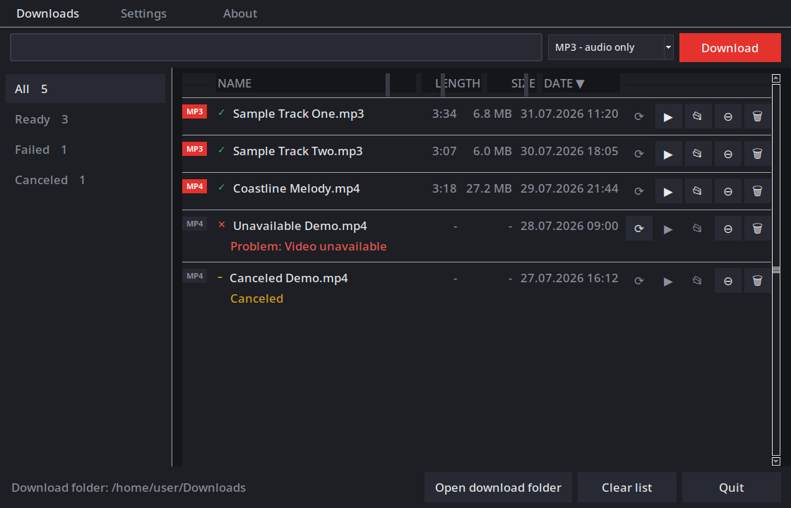
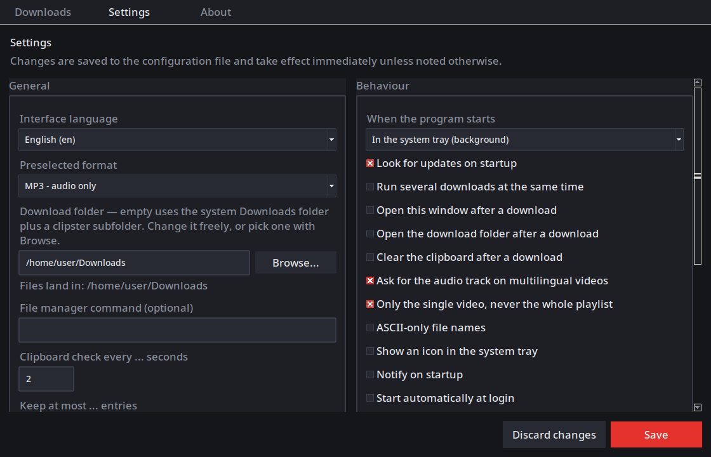

# User guide

End-user guide for **Loresoft YouTube Clipster** — clipboard downloads on Linux, Windows, and macOS.

Screenshots below use anonymized sample data.

## What Clipster does

- Watches your clipboard for YouTube links and downloads them as MP3 or MP4.
- Keeps a download history with open / folder / remove actions.
- Runs from the system tray (when available) so it stays out of the way.

## Install

### Linux

```bash
git clone https://github.com/joruf/youtube-clipster.git
cd youtube-clipster
chmod +x install.sh run.py
./install.sh
```

The installer installs missing system packages (may ask for `sudo`) and creates a private virtual environment. You can also run `python3 run.py`.

### Windows

```bat
git clone https://github.com/joruf/youtube-clipster.git
cd youtube-clipster
run.bat
```

Or double-click `run.bat`. It starts without a console window and shows a small setup window naming
whatever is being installed at that moment; when everything is in place the program starts by itself.
The first start takes a few minutes because `yt-dlp` and `ffmpeg` are downloaded. Use `install.bat` if
you would rather watch the whole log in a console window.

Allow Defender/SmartScreen prompts for yt-dlp and ffmpeg on first run.

### Requirements (handled automatically)

Python 3.8+, tkinter, yt-dlp, ffmpeg, and a clipboard helper on Linux (`xclip` or `wl-clipboard`). Optional: tray packages (`pystray`, Pillow, …).

## First start (terms)

On first launch Clipster asks you to accept the **general terms of use**. You must tick the checkbox and choose Accept; Decline quits the program.



Acceptance is stored locally in your config (`terms_*` keys) with a version and timestamp.

The About page can open the terms again in read-only form.



## Clipboard downloads

1. Leave Clipster running (tray or view window).
2. Copy a YouTube link (`youtube.com/watch`, `youtu.be`, Shorts, …).
3. The small navigation window opens: confirm **MP3** or **MP4**, and pick an audio language if asked.
4. Optionally fill in **Section** to keep only a part of the video (see below).
5. Watch progress; use Cancel if needed.
6. When finished, open the file or its folder from the nav window.

You can also paste a URL into the **Downloads** page and press Download.



Tips:

- Several links queue up (they are not dropped while a download runs).
- The same URL + format is not downloaded again if the file still exists — you can open it or force a re-download.
- Files go to your Downloads folder unless you change **Download folder** in Settings.

### Only a section

The two small fields next to **Section** cut one piece out of the video instead of downloading all of it:

| From | To | Result |
|---|---|---|
| *(empty)* | *(empty)* | The whole video, as always |
| `0:45` | `2:10` | Everything between those two points |
| `1:30` | *(empty)* | From there to the end |
| *(empty)* | `0:30` | The first 30 seconds |

Times are written as `1:23` (minutes:seconds), `1:02:03` (hours:minutes:seconds) or as plain seconds (`90`). A field that is not a time — or an end before the start — is reported right in the window; nothing is downloaded until it makes sense.

The cut lands exactly on the second you named, not on the nearest keyframe, so the section is re-encoded and takes a little longer than the same amount of a plain download.

The file keeps the video title and says which piece it is: `Some song [0-45_2-10].mp3`. That way a section and the full video can sit next to each other, and downloading the same section twice is recognised just like a repeated full download. The section belongs to that one link — the next link starts with empty fields again.

### Working with the list

The **Downloads** page is a table you can arrange:

- **Sort** — click *Name*, *Length*, *Size* or *Date*. Clicking the same heading again reverses the order; an arrow marks the column in use. Length, size and date sort by their real value, not by the text, so `9 MB` stays below `10 MB`. The list starts with the newest download on top.
- **Column widths** — drag the divider on the right of *Length*, *Size* or *Date*. The name column takes whatever is left over, so pulling the others in gives long file names more space. The pointer turns into a double arrow over a divider.
- **Long names** — names too long for the column end in `…`; rest the pointer on one to see it in full.

Sorting and column widths apply to the window you are working in and start fresh on the next start.

## Settings



Useful options:

- Language (English / German)
- Default format (MP3 / MP4)
- Download folder and clipboard interval
- Tray / start minimized
- Parallel downloads
- **YouTube cookies** — if downloads fail with “Sign in to confirm you’re not a bot”, set **Cookies from browser** (Firefox, Chrome, Chromium, Brave, or Edge while logged into YouTube) or point to a `cookies.txt` export. Clipster never logs cookie contents.
- Update checks

Changes save to `config.json` (see paths below). A full key list is in the [README](../README.md#configuration) and [technical docs](TECHNICAL.md#configuration-keys-overview).

## Updates

If update checks are enabled, Clipster compares your install to the `main` branch on GitHub. From **About** you can check and apply updates when available.

- Git clone: fast-forward `git pull` when the tree is clean.
- Archive install: download ZIP overlay without touching your config or history.

Which version you have is read from git in a clone, and from a small marker file
(`clipster/BUILD_COMMIT`) in every other kind of install, which carries no `.git`. The marker is
written when the installation is packed and again after every update. An installation that predates this and has no marker says so and offers to fetch the
newest version rather than claiming to be current.

yt-dlp itself is updated on its own schedule (`update_check_hours`), or force with `python3 run.py --update`.

## Configuration paths

| Platform | Directory |
|----------|-----------|
| Linux / macOS | `~/.local/share/YoutubeClipster/` |
| Windows | `%LOCALAPPDATA%\YoutubeClipster\` |

Contains `config.json`, `history.json`, the log file, and the private venv. For a portable checkout, copy `config.example.json` to `config.json` next to `run.py`.

## Troubleshooting basics

**Clipboard not detected (Linux)**  
Install `xclip` (X11) or `wl-clipboard` (Wayland). Run with `--verbose` and look for `Clipboard backend: …`.

**No tkinter**  
Linux: install `python3-tk` (or distro equivalent). Windows: repair Python with tcl/tk enabled.

**Tray missing or no menu**  
The app still works — the view window stays available. Install tray deps / AppIndicator support, or use `--no-tray`. See the README troubleshooting section for package names.

**Already running**  
Only one instance is allowed. Quit from the tray or view window, or end the process.

**Downloads fail (“not a bot” / unavailable)**  
In **Settings**, set YouTube cookies from your browser or a cookies file, wait a bit, or update yt-dlp (`--update`). Check the failed row’s problem text on the Downloads page.

**Broken environment**  
`python3 run.py --reinstall` rebuilds the venv.

Logs: `youtube-clipster.log` next to your config. Start with `python3 run.py --verbose` when reporting issues.

## More documentation

- [Technical documentation](TECHNICAL.md) — architecture, module map, config keys, testing
- [README](../README.md) — features, installer details, CLI flags
